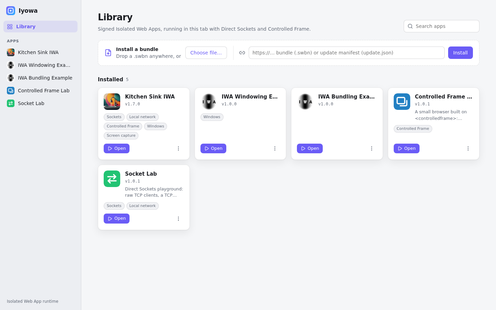
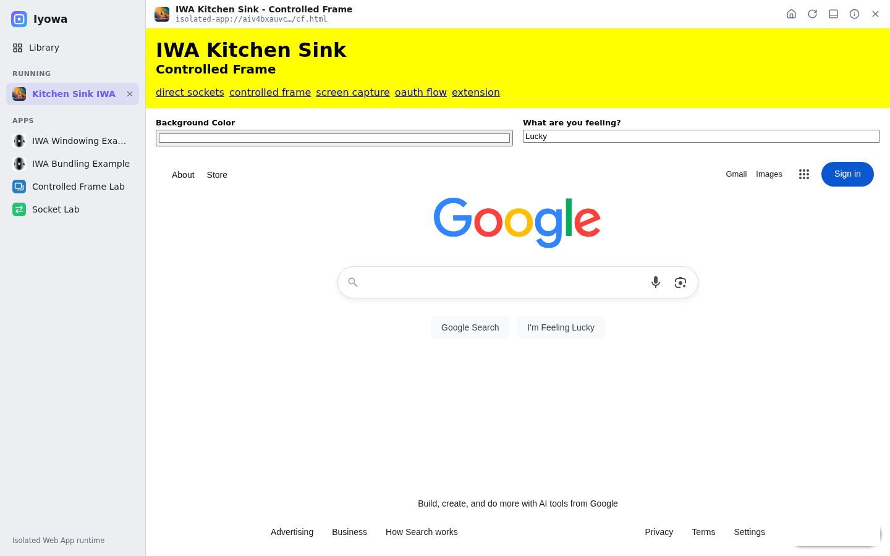
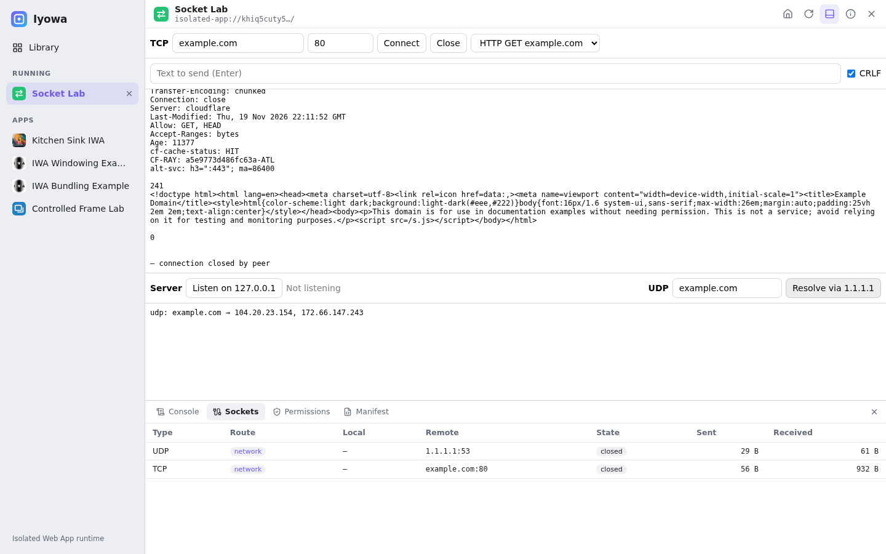

<p align="center">
  
</p>

<h1 align="center">Iyowa</h1>

<p align="center">
  <strong>Run signed Isolated Web Apps in an ordinary Chromium tab.</strong><br>
  Direct Sockets, Controlled Frame and screen capture without ChromeOS, enterprise policy or flags.
</p>

<p align="center">
  <a href="https://github.com/hazelcaffe/Iyowa/actions/workflows/ci.yml"></a>
  <a href="https://hazelcaffe.github.io/Iyowa/"></a>
  <a href="LICENSE"></a>
</p>



[Isolated Web Apps](https://github.com/WICG/isolated-web-apps) are signed bundles that Chrome installs and runs with powerful APIs, such as raw TCP and UDP sockets and a `<controlledframe>` that can embed and script any website. Running one usually requires a managed ChromeOS device or developer flags. Iyowa verifies the bundle, serves it from its own origin on `localhost`, and emulates the IWA platform, so apps like the [ChromeOS Kitchen Sink](https://github.com/chromeos/iwa-sink) run **unmodified** in a normal tab.

## Features

- **Verified installs.** Drop a `.swbn`, choose a file, or paste a bundle or `update.json` URL. Iyowa checks the signature (Ed25519 or P-256, current and legacy formats), and updates must keep the signing key.
- **Direct Sockets.** `TCPSocket`, `TCPServerSocket` and `UDPSocket` with streams, BYOB reads and multicast, over a policy-checked [Wisp](https://github.com/MercuryWorkshop/wisp-protocol) relay or real OS ports.
- **Controlled Frame.** `<controlledframe>` runs any site through a per-partition [Scramjet](https://github.com/MercuryWorkshop/scramjet) proxy with in-browser TLS ([libcurl.js](https://github.com/ading2210/libcurl.js)). It supports script and CSS injection, request interception, context menus, `newwindow`, cookies and WebSockets.
- **The rest of the platform.** `getAllScreensMedia()`, `display-mode: unframed`, in-tab popups, `launchQueue`, protocol handlers, and the app's own service workers.
- **One permission to think about.** Public internet access follows the manifest. Reaching this computer or your LAN asks first, and if you block it, the app's sockets stay inside the tab.
- **A launcher with developer tools.** A library, multiple running apps, a console, live socket inspection, a permissions editor, and a manifest viewer.
- **An SDK.** The launcher is a client of `@iyowa/sdk`. Use the same API to embed IWAs in your own UI.

|  |  |
| :------------------------------------------------------------------------------------------------: | :----------------------------------------------------------------------------: |
|                      Kitchen Sink drives a live site in its controlled frame                       |                 Raw TCP and UDP, inspected in developer tools                  |

## Quick start

Requires [Node.js](https://nodejs.org/) 24 or newer and a current Chromium-based browser (Chrome, Edge, Brave, and so on).

```sh
git clone https://github.com/hazelcaffe/Iyowa.git
cd Iyowa
corepack enable        # provides the pnpm version pinned in package.json
pnpm install
pnpm dev               # open http://localhost:4178
```

Install **Socket Lab** or **Controlled Frame Lab** from **Try an app**, or install a public IWA such as the Kitchen Sink from its update URL. For a production build, run `pnpm build && pnpm start`.

| Variable     | Default    | Meaning                                                                          |
| ------------ | ---------- | -------------------------------------------------------------------------------- |
| `PORT`       | `4178`     | Launcher port. Keep it stable: each app's browser storage belongs to its origin. |
| `IYOWA_DATA` | `./.iyowa` | Installed bundles and per-app permissions.                                       |

The server listens on `127.0.0.1` only. Chromium resolves `*.localhost` itself, so no hosts-file setup is needed.

## Documentation

- [How Iyowa works](docs/architecture.md): origins, the in-app runtime, socket routes and the controlled-frame proxy
- [SDK reference](docs/sdk.md): the browser API (`IwaRuntime`, `IwaSession`) and the Node host
- [Compatibility](docs/compatibility.md): what is tested, against which apps, and where behavior differs from ChromeOS

These docs are also published at **[hazelcaffe.github.io/Iyowa](https://hazelcaffe.github.io/Iyowa/)**.

## Permission model

The manifest's `permissions_policy` decides what an app may use, as it does for an installed IWA in Chrome. Iyowa asks you about one thing, **local network access**:

| An app that declares                        | Can                                                                   | And, if you allow local network access                        |
| ------------------------------------------- | --------------------------------------------------------------------- | ------------------------------------------------------------- |
| `direct-sockets`                            | connect to public internet addresses, and use loopback inside the app | n/a                                                           |
| `direct-sockets` + `direct-sockets-private` | the same                                                              | reach this computer and your LAN, and listen on real OS ports |
| `controlled-frame`                          | show public websites in frames                                        | also show LAN and loopback sites                              |

Checks happen in the relay, at the address it actually connects to after DNS resolution. Answers are saved per app and can be changed in **Developer tools → Permissions** or **App info**.

## Project layout

```
packages/
  sdk/    @iyowa/sdk: bundle verification, host, in-app runtime, frame proxy, browser SDK
  ui/     @iyowa/ui: the React launcher
  site/   the GitHub Pages site, generated from docs/
docs/     documentation and screenshots
```

## Development

```sh
pnpm dev                                 # launcher with hot reload; restarts when SDK sources change
pnpm check                               # Biome lint and format, strict TypeScript
pnpm exec playwright install chromium    # once
pnpm test                                # unit tests and SDK and launcher end-to-end tests in Chromium
pnpm test:public                         # also downloads pinned upstream IWAs and runs them unmodified
```

See [CONTRIBUTING.md](CONTRIBUTING.md) for conventions and how to add tests.

## Security

Iyowa is a compatibility environment, not a security boundary equivalent to ChromeOS's IWA isolation. It runs apps you choose on origins served by a local process. Only install bundles you trust: a valid signature proves which key signed the bundle, not that the publisher is trustworthy. To report a vulnerability, see [SECURITY.md](SECURITY.md).

## License

Iyowa is licensed under the [GNU Affero General Public License v3.0 or later](LICENSE).

It builds on [Scramjet](https://github.com/MercuryWorkshop/scramjet) (AGPL-3.0-only), [libcurl.js](https://github.com/ading2210/libcurl.js) and [wisp-js](https://github.com/MercuryWorkshop/wisp-js) (LGPL-3.0-or-later), [wbn and wbn-sign](https://github.com/WICG/webpackage) (W3C Software License), and [React](https://react.dev/), [ws](https://github.com/websockets/ws), [ipaddr.js](https://github.com/whitequark/ipaddr.js), [cborg](https://github.com/rvagg/cborg) and [Lucide](https://lucide.dev/). Example apps are signed with deterministic, **public** demo keys. Don't reuse them.
